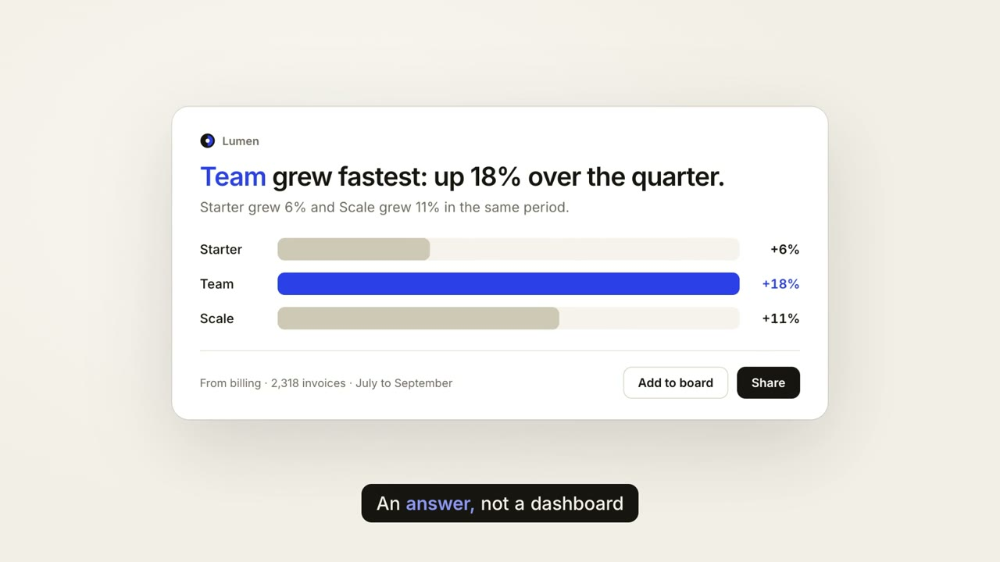

# HyperStudio

[](https://github.com/FjrREPO/hyperstudio/actions/workflows/ci.yml)
[](LICENSE)

A creative direction layer on top of [HyperFrames](https://github.com/heygen-com/hyperframes) for product and
brand films. You record the direction and the shots as one JSON plan; HyperStudio checks the plan against that
direction and writes a HyperFrames project; HyperFrames validates, previews and renders it.

HyperStudio adds three things, and nothing HyperFrames already does:

1. **Creative IR**: the film's direction, what in it is real, and its shots, in one typed document.
2. **A deterministic compiler** that refuses careless work: repeated shots, invented statistics, per-scene
   colour changes, copy too long for its frame. The same plan always compiles to the same project.
3. **Shot recipes** in HyperFrames' own registry format: a real product screen with a camera, cursor and
   typing; a line of copy; a brand close.

Then a review step: frames from every shot and a rubric to answer from them. A passing check is not a
finished film.



## Requirements

Node ≥ 24, pnpm 12, FFmpeg, and Chrome (HyperFrames uses them; `npx hyperframes doctor` checks).

## Quick start

```bash
pnpm install
pnpm hyperstudio recipes
pnpm hyperstudio compile examples/saas-product-showcase/video.json
pnpm hyperstudio review  examples/saas-product-showcase/video.json    # check + frames + REVIEW.md

cd examples/saas-product-showcase/build
npx hyperframes render --quality looks -o ../renders/saas-product-showcase.mp4
```

## Commands

| Command                                                                         | Does                                                                                   |
| ------------------------------------------------------------------------------- | -------------------------------------------------------------------------------------- |
| `pnpm hyperstudio compile <ir.json> [-o dir] [--validate-only]`                 | Validate an IR and write a HyperFrames project                                         |
| `pnpm hyperstudio review <ir.json>`                                             | Compile, run `hyperframes check`, snapshot every shot, start `REVIEW.md`               |
| `pnpm hyperstudio recipes [name]`                                               | List the recipes, or show one recipe's variables                                       |
| `pnpm hyperstudio audio providers \| tts \| voices \| dub \| inspect \| status` | Voiceover and dubbing: local and free by default; ElevenLabs only when named and keyed |
| `pnpm mcp -- --workspace <dir>`                                                 | MCP server for agents (STDIO; `--http <port>` with a token)                            |
| `pnpm api -- --workspace <dir>`                                                 | REST API (needs `HYPERSTUDIO_API_KEY`)                                                 |
| `--json`, `--pretty`                                                            | Machine-readable output for any command that prints a result                           |
| `pnpm verify`                                                                   | Biome, type check and tests                                                            |
| `pnpm deps:update`                                                              | Update every dependency with npm-check-updates, then verify                            |
| `pnpm skill:link`                                                               | Link the skill into `.claude/skills/` for Claude Code in this repo                     |

Exit codes: 0 success, 1 the IR was rejected or a check failed, 2 the command line was wrong.

## Recipes

| Recipe                  | The shot                                                                                                                                                                    | Needs                           |
| ----------------------- | --------------------------------------------------------------------------------------------------------------------------------------------------------------------------- | ------------------------------- |
| `product-shot`          | A real product screen: the camera moves between named regions; optional cursor and click, typed text, outlined component, label; one component can be isolated on the stage | A screenshot with named regions |
| `statement`             | One short line of copy with at most one emphasised word                                                                                                                     | Nothing                         |
| `brand-close`           | Mark, name, tagline, optional button                                                                                                                                        | The brand mark                  |
| `luxury-product-reveal` | A physical product emerging from darkness                                                                                                                                   | A cut-out product image         |

## Examples

| Example                                                       | Length             | What it is                                                                                                                                                                                                                                                                                                |
| ------------------------------------------------------------- | ------------------ | --------------------------------------------------------------------------------------------------------------------------------------------------------------------------------------------------------------------------------------------------------------------------------------------------------- |
| [`saas-product-showcase`](examples/saas-product-showcase)     | 29.6 s, and 15.4 s | The quality benchmark: a product mounted live and driven. `video.json` is the 30-second editorial film (the old way, a reveal, the product asked twice, the brand); `video-dark.json` is a 15-second cinematic cut of the same product. Reviewed in [REVIEW.md](examples/saas-product-showcase/REVIEW.md) |
| [`marlow-launch-film`](examples/marlow-launch-film)           | 29 s, one take     | The generalisation test: a second product in a direction that shares nothing with Lumen's but the method. The product fills the frame and the words run in a band beneath it. Reviewed in [REVIEW.md](examples/marlow-launch-film/REVIEW.md)                                                              |
| [`meeting-notes-launch`](examples/meeting-notes-launch)       | 17.7 s, 10 shots   | A second product in a different art direction: warm editorial stage, serif voice, each click followed by its result. Reviewed in [REVIEW.md](examples/meeting-notes-launch/REVIEW.md)                                                                                                                     |
| [`luxury-watch-commercial`](examples/luxury-watch-commercial) | 16.2 s, 3 scenes   | A slow film for a physical product                                                                                                                                                                                                                                                                        |

The products are **examples made for these films**, and every compile lists them as placeholders. The
benchmark's interface is real HTML (`product/index.html`), screenshotted state by state.

## Layout

```
packages/
  ir/          @hyperstudio/ir        The Creative IR schema (Zod)
  compiler/    @hyperstudio/compiler  IR → HyperFrames project; the only code that knows HyperFrames
  recipes/     @hyperstudio/recipes   blocks/<name>/{registry-item.json, <name>.html}
  assets/      @hyperstudio/assets    Free asset search, the licence gate, the download ledger
  audio/       @hyperstudio/audio     Voiceover and dubbing providers, estimates, cost controls
  studio/      @hyperstudio/studio    The whole engine behind one API: projects, review, render jobs
  mcp/         @hyperstudio/mcp       MCP server: tools, resources, prompts (STDIO and HTTP)
  api/         @hyperstudio/api       Versioned REST API, generated from a route table
  sdk/         @hyperstudio/sdk       TypeScript client: local engine or remote API
  cli/         hyperstudio            compile, review, recipes, assets, audio
skills/                               hyperstudio-director (make a film), hyperstudio-review (judge one)
examples/                             A film per folder: video.json, screens/, assets/, REVIEW.md
tests/                                integration/ and regression/ (unit tests sit beside the code)
docs/
```

## Documentation

- [IR specification](docs/IR-SPECIFICATION.md)
- [Compiler](docs/COMPILER.md)
- [Recipe development](docs/RECIPE-DEVELOPMENT.md)
- [Example workflow](docs/EXAMPLE-WORKFLOW.md)
- [Asset engine](docs/ASSET-ENGINE.md) · [Asset licensing](docs/ASSET-LICENSING.md)
- [Agent integration](docs/AGENT-INTEGRATION.md) · [MCP server](docs/MCP-SERVER.md) · [REST API](docs/REST-API.md) ·
  [SDK](docs/SDK.md) · [Claude Code](docs/CLAUDE-CODE.md) · [Codex](docs/CODEX.md) · [Other agents](docs/OTHER-AGENTS.md) ·
  [Security](docs/SECURITY.md)
- [Audio engine](docs/AUDIO-ENGINE.md) · [ElevenLabs](docs/ELEVENLABS-INTEGRATION.md) ·
  [Cost controls](docs/AUDIO-COST-CONTROLS.md) · [Audio licensing](docs/AUDIO-LICENSING.md)
- [Creative quality review and proposal](docs/CREATIVE-QUALITY-PROPOSAL.md): why the first approach was replaced
- [Architecture](docs/ARCHITECTURE.md) · [Technical decisions](docs/TECHNICAL-DECISIONS.md) ·
  [HyperFrames research](docs/HYPERFRAMES-RESEARCH.md)

## Limits

- The compiler's checks catch carelessness; they do not measure taste. That is judged from frames, in review.
- Four recipes. One recipe per scene.
- Camera moves and tilts are 2.5D transforms of flat images.
- Typing and the cursor are drawn over a screenshot; other interface changes need a screenshot per state.
- Transitions are `cut`, `fade` and `crossfade`.
- `build/` is regenerated on every compile, so manual or Studio edits there do not survive.
- The CLI runs as TypeScript through Node's type stripping: from a checkout, not as an installed dependency.

## Contributing

See [CONTRIBUTING.md](CONTRIBUTING.md). Changes are listed in [CHANGELOG.md](CHANGELOG.md).

## Licence

[MIT](LICENSE). HyperFrames is a separate project under Apache-2.0.
