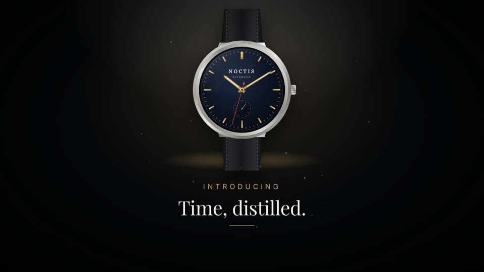
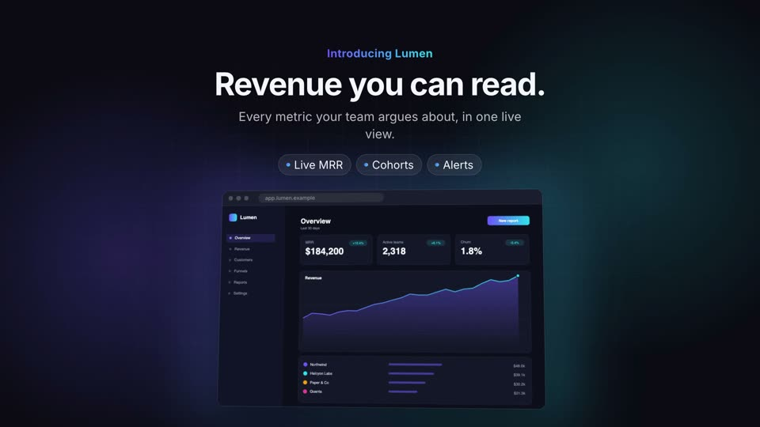
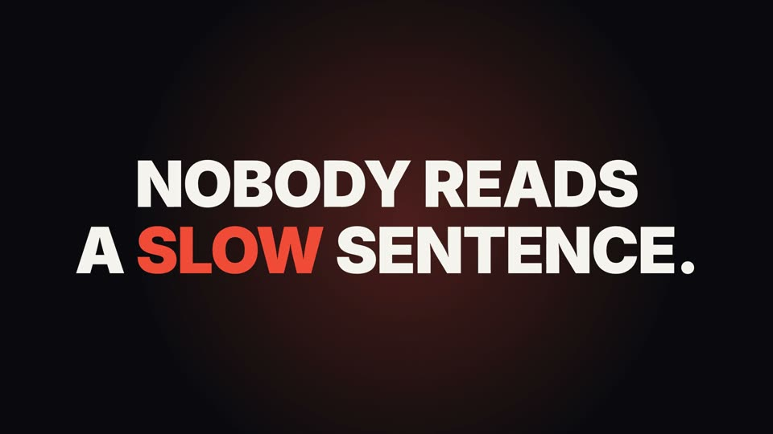
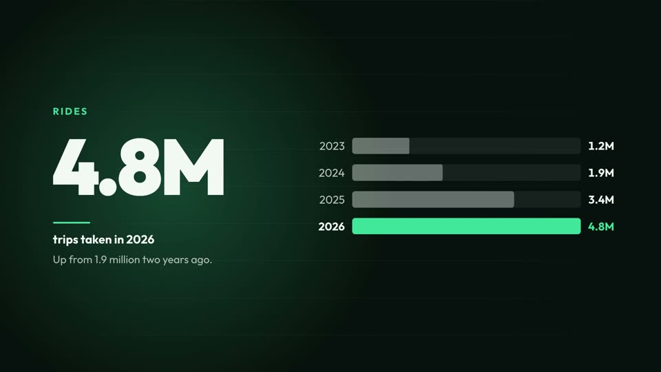
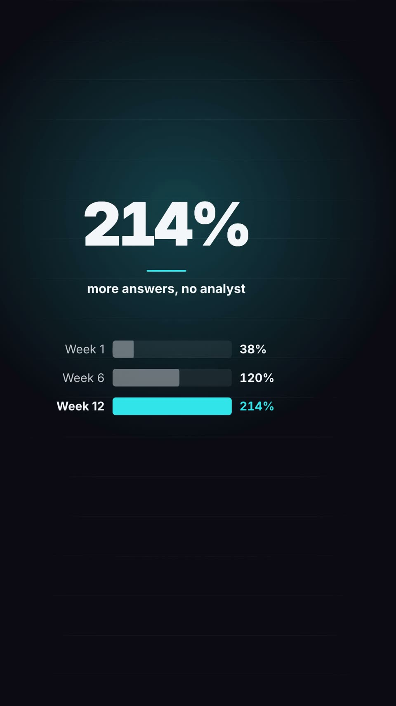

# HyperStudio

[](https://github.com/FjrREPO/hyperstudio/actions/workflows/ci.yml)
[](LICENSE)

A creative layer on top of [HyperFrames](https://github.com/heygen-com/hyperframes). You describe a video as a
small JSON plan; HyperStudio validates it and writes a HyperFrames project; HyperFrames checks, previews and
renders it.

HyperStudio adds two things HyperFrames does not have, and nothing else:

1. **Creative IR + deterministic compiler** — a typed plan (scenes, recipes, values, transitions, audio) that
   compiles to the same project every time.
2. **Cinematic recipes** — whole shots with composition, timing, motion, camera, lighting and typography
   already decided, written in HyperFrames' own registry block format.

Animation, variable binding, audio mixing, validation, snapshots and rendering stay with HyperFrames.

## Requirements

Node ≥ 24, pnpm 12, FFmpeg, and Chrome (HyperFrames uses them; `npx hyperframes doctor` checks).

## Quick start

```bash
pnpm install
pnpm hyperstudio recipes --pretty                                             # what you can use
pnpm hyperstudio compile examples/luxury-watch-commercial/video.json    # writes .../build/

cd examples/luxury-watch-commercial/build
npx hyperframes check --json
npx hyperframes snapshot
npx hyperframes render --quality looks -o ../renders/noctis-one.mp4
```

## Recipes

| Recipe                  | The shot                                                                                           | Needs                   |
| ----------------------- | -------------------------------------------------------------------------------------------------- | ----------------------- |
| `luxury-product-reveal` | A product emerges from darkness under a controlled light, with a glint, dust and a serif headline  | A cut-out product image |
| `tech-product-launch`   | A product screen in a device frame floats in perspective over a gradient field, with feature chips | A screenshot            |
| `kinetic-typography`    | Up to four lines sized to fill the canvas and choreographed word by word                           | Nothing                 |
| `data-storytelling`     | One number counted up large, with an optional bar chart                                            | Nothing                 |

`pnpm hyperstudio recipes` lists every variable. All four work in landscape, square and portrait.

## Examples

Each folder under `examples/` holds an IR (`video.json`) and its assets. All seven pass `hyperframes check`
with no errors or warnings and have been rendered.

|                                                                       | Example                   | Length | Recipes                            |
| --------------------------------------------------------------------- | ------------------------- | ------ | ---------------------------------- |
|  | `luxury-watch-commercial` | 16.2 s | luxury ×3                          |
|      | `saas-product-launch`     | 23 s   | kinetic, tech, data, tech, kinetic |
|       | `kinetic-typography`      | 13.6 s | kinetic ×3                         |
|       | `data-visualization`      | 18.4 s | kinetic, data ×3                   |
|      | `web3-protocol-promo`     | 18.2 s | kinetic, tech, data, kinetic       |
|  | `luxury-brand-commercial` | 19.6 s | kinetic, luxury ×2, kinetic        |
|             | `social-short` (9:16)     | 16.3 s | kinetic, data, tech, kinetic       |

Render one: `pnpm hyperstudio compile examples/<name>/video.json`, then in `examples/<name>/build` run
`npx hyperframes render --quality looks -o ../renders/<name>.mp4`.

## Layout

```
packages/
  ir/          @hyperstudio/ir        Zod schema of the Creative IR
  compiler/    @hyperstudio/compiler  IR → HyperFrames project (the only code that knows HyperFrames)
  recipes/     @hyperstudio/recipes   blocks/<name>/{registry-item.json, <name>.html}
  cli/         hyperstudio            `hyperstudio compile`, `hyperstudio recipes`
skills/
  hyperstudio-director/               Claude Code skill: brief → IR → compile → check → render
examples/
  luxury-watch-commercial/            IR + assets; build/ and renders/ are generated
docs/                                 research, architecture, specifications
```

## Commands

| Command                                                                          | Does                                                               |
| -------------------------------------------------------------------------------- | ------------------------------------------------------------------ |
| `pnpm hyperstudio compile <ir.json> [--output dir] [--validate-only] [--pretty]` | Validate an IR and write a project                                 |
| `pnpm hyperstudio recipes [--pretty]`                                            | List recipes and their variables                                   |
| `pnpm verify`                                                                    | Biome lint, type check and tests                                   |
| `pnpm lint:fix`                                                                  | Apply Biome fixes and formatting                                   |
| `pnpm skill:link`                                                                | Link the skill into `.claude/skills/` for Claude Code in this repo |

Husky runs Biome on staged files and the type check before each commit, and the tests before each push.

## Documentation

- [IR specification](docs/IR-SPECIFICATION.md)
- [Compiler](docs/COMPILER.md)
- [Recipe development](docs/RECIPE-DEVELOPMENT.md)
- [Example workflow](docs/EXAMPLE-WORKFLOW.md)
- [Architecture](docs/ARCHITECTURE.md) · [Technical decisions](docs/TECHNICAL-DECISIONS.md) ·
  [HyperFrames research](docs/HYPERFRAMES-RESEARCH.md)

## Limits

- One recipe per scene; recipes are not layered inside a scene.
- Transitions are `cut`, `fade` and `crossfade`. HyperFrames' registry and shader transitions are not wired in.
- Camera moves are 2.5D simulations on flat images.
- `build/` is regenerated on every compile, so manual or Studio edits there do not survive.
- The CLI runs as TypeScript through Node's type stripping, so it works from a checkout, not as an installed dependency.
- Product images, screens and music in the examples are stand-ins made for the demos.

## Contributing

See [CONTRIBUTING.md](CONTRIBUTING.md). Changes are listed in [CHANGELOG.md](CHANGELOG.md).

## Licence

[MIT](LICENSE). HyperFrames is a separate project under Apache-2.0.
